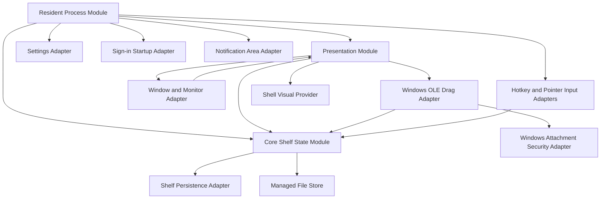
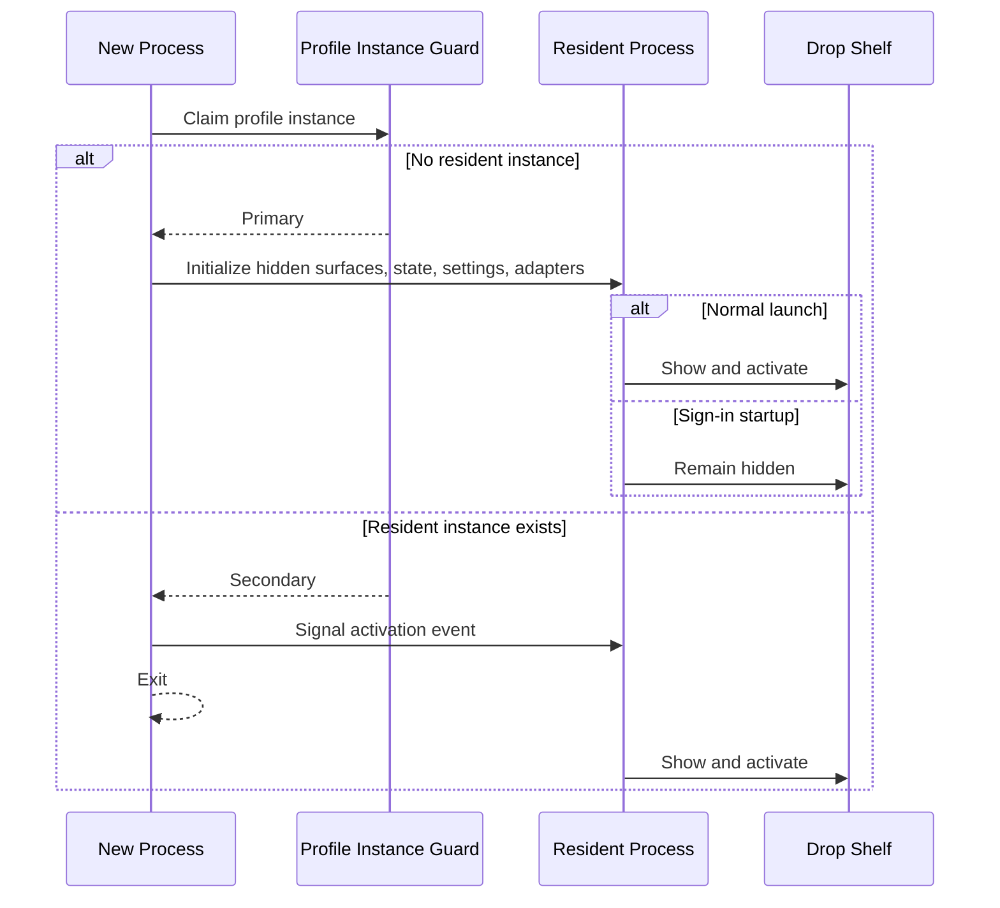
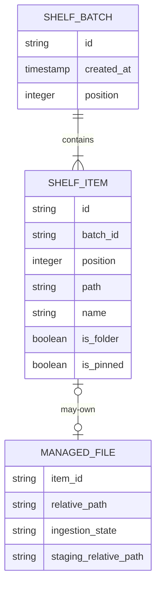
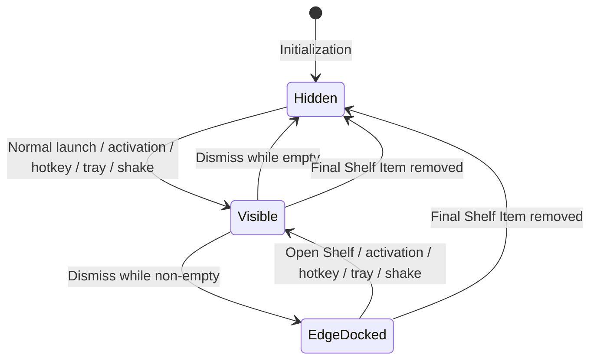
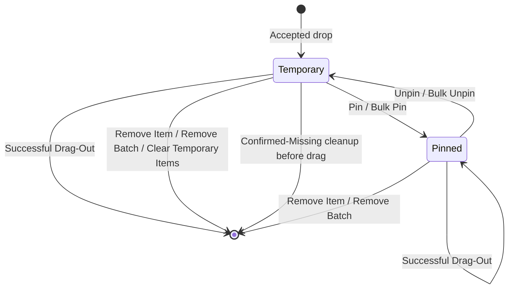
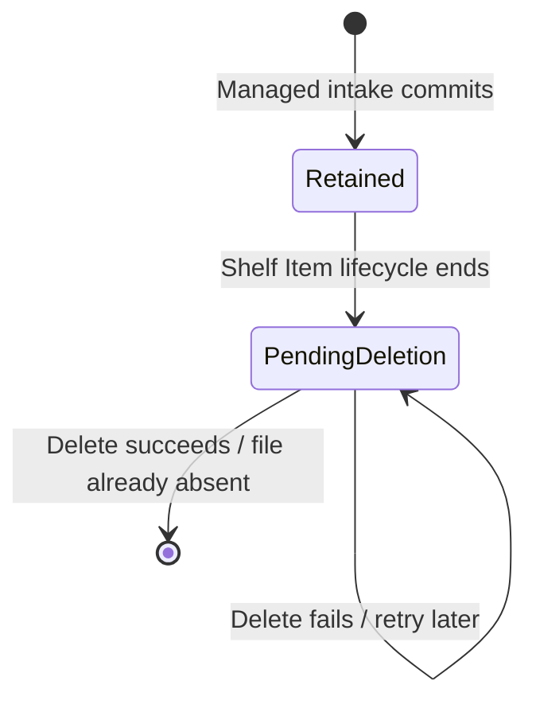
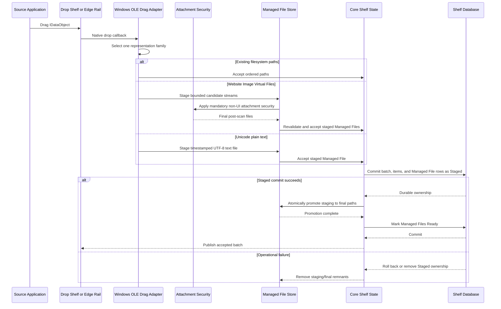
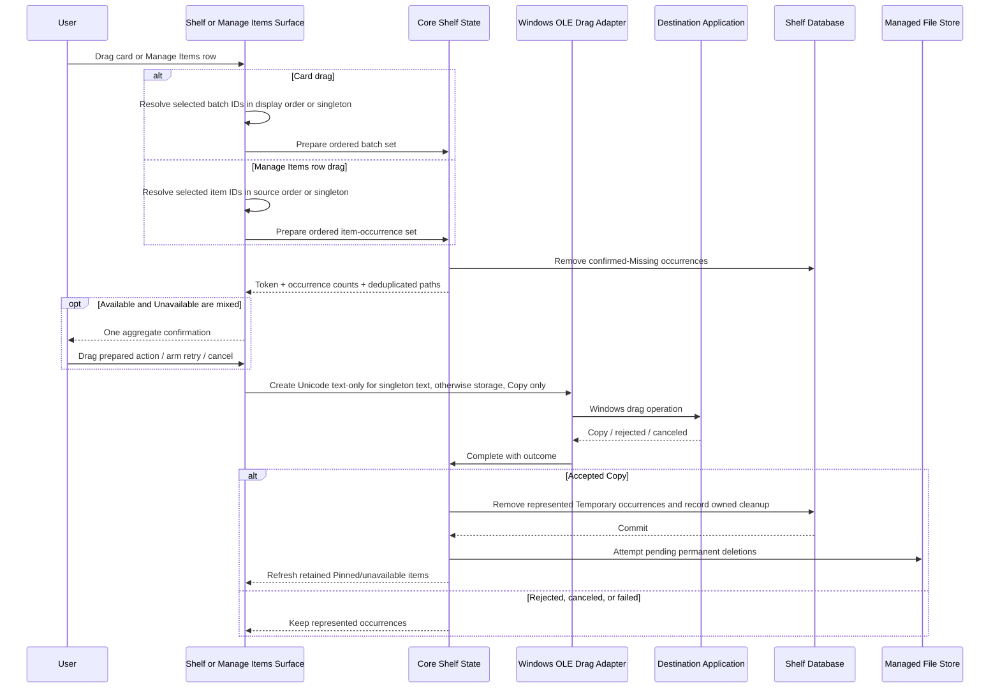
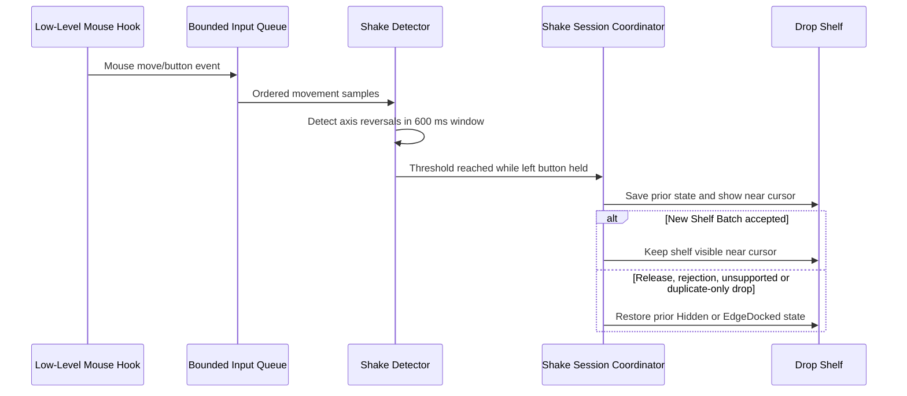

# DropCove Architecture

> Canonical target architecture for DropCove.

This document defines the architecture required to implement the target DropCove application on Windows. It is Windows-specific but implementation-language-neutral. Product behavior, installation, settings, and user workflows are defined in [SPECIFICATION.md](SPECIFICATION.md).

[`DropCove.md`](DropCove.md) is retained as implementation history and design evidence. If it conflicts with this document or `SPECIFICATION.md`, the two canonical documents take precedence.

## 1. Architectural goals

DropCove is a resident, event-driven utility. Its architecture preserves these invariants:

1. **External references, managed representations** — ordinary file and folder drops store paths only; supported non-filesystem drops become app-owned Managed Files so every Shelf Item still resolves through a filesystem path.
2. **One state owner** — all Shelf Batch, Shelf Item, Managed File ownership, display, placement, and sizing mutations pass through one core state module.
3. **Explicit deletion authority** — lifecycle removal can permanently delete only Managed Files owned by DropCove, never external referenced objects.
4. **Durable user-visible mutations** — accepted drops, pinning, removals, drag-out consumption, pending cleanup, rail placement, and retained sizing intent are persisted.
5. **Event-driven residency** — hotkeys, pointer hooks, drag events, cleanup-producing mutations, foreground changes, display changes, and window messages drive work. There is no continuous polling loop.
6. **Disposable presentation state** — windows project core state; Batch Selection, Item Selection, and other surface state never become a second durable state owner.
7. **Windows interoperability behind adapters** — global input, OLE data formats, attachment security, shell drag-and-drop, monitor geometry, z-order, tray integration, and shell visuals remain isolated from domain rules.
8. **Safe failure preference** — an extra retained reference or durable Pending Managed File Deletion is safer than incorrectly losing user-visible state or leaking cleanup responsibility.

## 2. Module map



### 2.1 Resident Process Module

Owns application lifetime:

- resolves the per-user profile directory;
- enforces one resident instance per profile;
- redirects later launches to the existing instance;
- initializes persistence, settings, tray, hotkey, shake detection, and windows;
- distinguishes normal launch from sign-in startup;
- exits only through the notification-area **Exit DropCove** command, installer shutdown request, or a fatal startup error.

Its interface is small: initialize, show the shelf, open Settings or About, and exit. The notification-area menu and Drop Shelf utilities reuse the same singleton openers rather than constructing independent windows.

### 2.2 Presentation Module

Owns transient Windows surfaces:

- floating **Drop Shelf**;
- docked **Edge Rail** and its **Rail Handle**;
- **Manage Items** popup or flyout;
- Settings window;
- About Surface;
- confirmations, status messages, and drag feedback.

Presentation surfaces render projections of core state. They request mutations through the Core Shelf State Module and refresh only after an operation succeeds or a documented rollback completes.

The dedicated Drop Shelf Clear confirmation is a resident-owned native window, not a WebView overlay. It disables native interaction with its owner and guards resident dismissal, movement, resize, OLE drop, and frontend mutation requests until cancellation or confirmation. Its request/confirm lifecycle rechecks authoritative Shelf state and delegates to the existing Core Shelf State mutation. Cancellation, close, setup failure, and shutdown release modal ownership; Edge Rail confirmation ownership remains unchanged.

Selection-removal confirmation is presentation-owned rather than a second durable state owner. Focus-capable Drop Shelf and Manage Items origins use an owning-surface modal; Edge Rail and Rail-origin Manage Items use inline pointer confirmation with transient hold and no activation. The confirmation descriptor comes from authoritative Core Shelf State identities and counts, blocks competing originating-surface mutations, and is revalidated before one atomic removal. Cancel, stale-target rejection, and setup failure release ownership without mutation.

The About Surface has a separate, non-modal singleton lifecycle and a read-only metadata projection. Product name and version come from the running Tauri package; author, description, and Source come from Cargo package metadata. The frontend renders the description immediately below the version without another metadata owner. Homepage remains absent until there is a product site. Its window is denied unrelated custom commands, while capabilities allow only its required window lifecycle and canonical external Source link. The Clear window similarly receives only its confirmation interface and core window/event access.

Settings is a resident-managed top-level singleton rather than a native owned Drop Shelf window, so it remains reachable through the Windows taskbar while the Drop Shelf is hidden. General and Appearance share the existing resident-owned draft, Save/Cancel, focus-loss recorder cancellation, and shutdown coordinator. Appearance preview is a transient process-wide projection of that draft; it does not create a second state owner. Settings and About share the narrow native invocation-context placement adapter, not a generalized window manager.

### 2.3 Core Shelf State Module

Owns:

- newest-first Shelf Batch order;
- source-order Shelf Items within each batch;
- external-reference versus Managed File backing ownership;
- filesystem-batch duplicate suppression;
- Temporary and Pinned Item lifecycle;
- durable Pending Managed File Deletion responsibility;
- availability classification supplied at event boundaries;
- display state;
- remembered rail monitor;
- preferred width and optional Manual Height Override;
- preparation and completion of item-set, batch-set, and their singleton drag-out forms;
- serialized mutations.

This is the main seam for reproducing DropCove behavior. Presentation and platform adapters must not independently implement lifecycle, ownership, consumption, or cleanup rules.

### 2.4 Shelf Persistence Adapter

Stores durable Shelf state and pending Managed File cleanup in a per-user SQLite database using write-ahead logging. It serializes database operations and performs integrity checking during open.

### 2.5 Managed File Store

Owns staged and retained Managed File bytes under Profile Data, isolates user-visible filenames by Shelf Item identity, permanently deletes files requested by committed core mutations, and reports retryable failures. It never receives authority to delete an external reference.

### 2.6 Settings and Startup Adapters

- The Settings Adapter atomically reads and replaces a JSON settings file and owns the configured Rail preference, Shake preference, startup preference, hotkey, and `AppearanceMode`.
- The Startup Adapter owns the current-user Windows sign-in registration and launches DropCove with the hidden-start option.

### 2.7 Windows Integration Adapters

Separate adapters own:

- OLE drag-in format selection for filesystem paths, virtual image files, and Unicode text;
- copy-only path drag-out with destination result reporting;
- Windows Attachment Services and post-scan validation for website images;
- global hotkey registration;
- low-level mouse events for Shake-to-open;
- window styles, z-order, resize hit testing, DPI conversion, and monitor placement;
- foreground-window tracking for topmost repair and Edge Rail fullscreen policy;
- notification-area icon and menu;
- application appearance resolution, live Windows theme observation for System mode, Contrast Theme precedence, and native-frame synchronization;
- file/folder icons and image thumbnails.

## 3. Process and activation lifecycle



The instance identity is profile-specific. A normal profile and an explicit test profile can run independently because each has distinct storage paths, instance guards, and activation events.

## 4. Domain model

### 4.1 Entities and value state

| Concept | Durable fields | Rules |
|---|---|---|
| **Shelf Batch** | Identifier, creation time, position | Represents one accepted drop; ordered newest-first. |
| **Shelf Item** | Identifier, batch identifier, position, path, display name, folder flag, pinned flag | Represents one path occurrence; ownership is derived from the optional Managed File relation, never from path location. |
| **Managed File** | Shelf Item identity, final relative path, ingestion state, optional staging relative path | App-owned backing for exactly one Shelf Item; `Staged` is not projected, `Ready` is user-visible. |
| **Pending Managed File Deletion** | Cleanup identity and managed relative path | Survives after the Shelf Item is gone until permanent deletion succeeds or the target is already absent. |
| **Batch Selection** | Not persisted | Surface-local selected Shelf Batch identities plus an optional selection anchor and focused identity; current display order determines range and drag order. |
| **Item Selection** | Not persisted | Popup-local selected Shelf Item identities from one active Shelf Batch plus an optional selection anchor and focused identity; source order determines range and drag order. |
| **Display State** | Not persisted as a standalone value | `Hidden`, `Visible`, or `EdgeDocked`. |
| **Rail Placement** | Settings: target monitor identifier and `Left` or `Right` edge; shelf state: actual latest dock monitor identifier | A connected explicit target wins; fresh automatic dismissal follows the pointer, while restoration reuses docked placement. Fallback never rewrites the explicit preference. |
| **Sizing State** | Preferred logical width, nullable Manual Height Override | Automatic Shelf Sizing derives the exact current height from preferred width and responsive batch rows when manual height is absent. |
| **Availability** | Not persisted | Recomputed as `Available`, `Missing`, or `Unavailable` at restore and drag boundaries. |

### 4.2 Relationships



A Shelf Batch never owns a pinned state. Bulk Pinning derives the current tri-state from its Shelf Items and then updates every item atomically. Batch Selection contains batch identities; Item Selection contains item identities from one active batch. Both survive virtual-row mount churn and neither changes lifecycle or action scope merely by existing; explicit Selection Actions pass their exact domain-specific identities through serialized Core Shelf State mutation contracts.

## 5. State machines

### 5.1 Display state



Additional rules:

- Sign-in startup remains `Hidden` after initialization.
- `Hidden` can retain Shelf Items after sign-in startup and during temporary restoration flows; ordinary user dismissal with content produces `EdgeDocked`.
- Shake-to-open temporarily changes presentation placement. It does not introduce a fourth durable display state.
- Removing the final Shelf Item resets sizing state to its default and hides every shelf surface.

### 5.2 Shelf Item lifecycle



A Successful Drag-Out means that the destination reports the Windows `Copy` operation when the drag ends. It does not guarantee the destination's later internal processing.

Managed File cleanup has a separate durable state because the Shelf Item may disappear before Windows releases the backing file:



The mutation that ends the Shelf Item lifecycle records `PendingDeletion` atomically with reference removal. External references never enter this state machine.

## 6. Core mutation interfaces and invariants

The Core Shelf State Module exposes behavior equivalent to these operations:

| Operation | Result and invariant |
|---|---|
| Accept external storage drop | Creates zero or one Shelf Batch after path filtering and filesystem-batch duplicate suppression. |
| Accept Managed File drop | Reconciles staged bytes through durable `Staged` then `Ready` ownership; only `Ready` items become visible, and every crash window has deterministic startup recovery. |
| Pin or unpin one Shelf Item | Persists before callers observe the replacement item state. |
| Set all items pinned/unpinned | One durable operation; no batch-level pin field. |
| Remove Item | Removes one reference, records owned-file cleanup when required, and prunes an empty batch. |
| Remove Batch | Removes every item and records cleanup for every owned Managed File. |
| Pin or unpin a Batch Selection or Item Selection | Validates the complete non-empty unique identity set in its domain and changes every targeted Shelf Item in one durable operation. |
| Remove selected batches or selected items | Validates the complete domain-specific target, removes every target in one transaction, records all required owned-file cleanup, and prunes empty batches. |
| Clear Temporary Items | Removes only Temporary Items across all batches, records their owned-file cleanup, and preserves Pinned Items. |
| Prepare batch set drag | Reclassifies selected paths, durably removes Missing Items, retains Unavailable Items, deduplicates transfer paths, and records participating Available occurrences. |
| Complete item or batch-set drag | Consumes participating Temporary occurrences only after accepted `Copy`; Pinned occurrences remain. |
| Retry Managed File cleanup | Permanently deletes pending paths and removes records only after success or confirmed absence. |
| Dismiss shelf | Chooses `Hidden` when empty or records the actual dismissal monitor and chooses `EdgeDocked` when non-empty; rail edge and target-monitor preference remain settings-owned. |
| Save sizing intent | Persists while content exists; pending empty-shelf intent is persisted with the first accepted batch. |

Mutations are serialized. A persistence failure must not leave a user-observable partial mutation. Managed intake stages bytes before creating durable ownership, projects only `Ready` rows, and reconciles both database/filesystem crash windows before the Shelf is restored; lifecycle removal commits cleanup responsibility before attempting irreversible filesystem deletion.

Selection mutations keep batch and item identity domains separate. A batch-selection contract accepts Shelf Batch identities; an item-selection contract accepts Shelf Item identities and requires all of them to belong to the declared active Shelf Batch. Unknown, duplicate, stale, wrong-domain, or cross-batch identities reject the complete operation before writes. Multi-target callers never loop singleton commands because partial publication or cleanup authority is forbidden.

Read-only Item Actions resolve a retained Shelf Item identity and finite action against authoritative ownership. External References permit Show in File Explorer and Copy Path; ready plain-text Managed Files permit Copy Text; Managed Images permit neither. Snapshot and management projections carry `ownership` (`External` or `Managed`) and `managedContentKind` (`Text`, `Image`, or null), derived from existing Managed File records without a schema change. Cached availability does not gate action capability or live Managed Text reads. No item action enters drag preparation/completion, cleanup, Pin/selection mutation, or availability mutation.

Resolved owned data crosses into the Windows action adapter after releasing the Shelf store lock. Native Unicode clipboard writes use a live application HWND as clipboard owner and transfer movable-memory ownership to Windows only on successful SetClipboardData. Shell reveal balances COM initialization and PIDL resources, selects files/folders in their parent, and opens roots directly. Native failures retain Shelf state and scrub Managed File storage paths from user-facing errors.


## 7. Drag-in flow

DropCove consumes the native Windows OLE `IDataObject` through a Windows adapter and chooses one representation family: filesystem paths, otherwise Website Image Virtual Files, otherwise Unicode text. The `IDataObject` and borrowed COM media remain on the receiving window thread while virtual-file contents are copied in bounded chunks to owned staging files; only owned paths or staged files cross into trust, validation, and persistence work. `0.0.24` adds no separate progress or cancellation surface.



### 7.1 Representation and duplicate rules

- Representation families are never combined and invalid higher-priority data does not fall through to text or URL data.
- External paths retain source order, ordinal case-insensitive repeated-path filtering, no canonicalization, and exact retained-batch duplicate suppression.
- Website Image Virtual Files are capability-based rather than source-application-based. Current stable Edge and Chrome form the acceptance matrix; compatible sources outside that matrix are best-effort.
- Intake examines only the first `20` descriptors, enforces `100 MiB` encoded bytes per image, `500 MiB` accepted encoded bytes per drop, and `512 MiB` maximum decoded allocation per raster validation, and can accept a later in-range descriptor after skipping an earlier over-limit entry.
- Filenames use a sanitized basename and a content-matching extension, preserve duplicate source names, and use timestamped numeric-suffix fallbacks only when no safe basename remains.
- SVG validation disables DTD and entity expansion but preserves raw scripts and external references; no DropCove WebView renders SVG.
- Attachment Services is mandatory and non-interactive. Only explicit HTTP(S) `CFSTR_INETURLW/A` data supplies a source; otherwise Restricted Zone applies. Successful Windows policy is authoritative, and existing zone metadata is preserved.
- Final post-scan supported bytes are authoritative and remain byte-exact, including animation and metadata. Unsupported entries are counted, but an I/O, security, or persistence failure rejects the complete drop.
- Plain text creates one bounded UTF-8 Managed File.
- Managed content is not hashed, shared, or deduplicated by bytes; each accepted drop is distinct.

## 8. Drag-out flow



Card drag always uses the batch-set path. Dragging an unselected card prepares a singleton batch set; dragging a selected card prepares the complete surface-local Batch Selection. Manage Items row drag always uses the item-set path. Dragging an unselected row prepares one occurrence; dragging a selected row prepares the complete popup-local Item Selection in source order.

The two preparation entry points validate different identity domains. Batch preparation accepts unique Shelf Batch identities. Item preparation accepts unique Shelf Item identities and requires every identity to belong to the active Manage Items batch; item identifiers are never passed through the batch API. Both paths share lower-level availability classification, ordinal case-insensitive outbound-path deduplication, prepared-transfer recording, occurrence-safe completion, and Managed File cleanup.

Preparation and completion are intentionally separate. A preparation token is bound to the exact ordered selected identities and authoritative Shelf snapshot. It records every represented Available occurrence even when repeated paths emit once. Selection or Shelf mutation invalidates an armed token and requires cancellation followed by preparation again; confirmed-Missing cleanup remains committed.

Completion consumes the correct Temporary occurrences without consuming unrelated or currently Pinned items. Selection clearing is presentation-owned and independent of token completion. A requested popup close during an active native item drag becomes pending; the transfer completes against its recorded participants, and discarded Item Selection is not restored afterward.

## 9. Availability classification

Availability is evaluated at event boundaries, not through a filesystem watcher:

- application restore;
- shelf presentation refresh where required;
- immediately before batch-set or item-set drag-out.

Classification rules:

| State | Meaning | Drag preparation behavior |
|---|---|---|
| **Available** | Filesystem attributes can be read. | Participates in drag-out. |
| **Missing** | The item or directory is confirmed absent while its root remains available. | Reference is durably removed before drag begins; a Missing Managed File is treated as already deleted when cleanup responsibility applies. |
| **Unavailable** | The root, volume, network location, cloud provider, or permission state prevents a reliable existence decision. | Reference is retained and excluded from that drag. |

When a selected batch set contains both Available and Unavailable Items, presentation asks once whether to drag only the Available Items. Canceling that confirmation does not restore Missing Items already removed during preparation.

## 10. Persistence architecture

### 10.1 Shelf database

Default path:

```text
%LOCALAPPDATA%\DropCove\shelf.db
```

The database uses foreign keys, write-ahead logging, serialized access, and an integrity check on open.

| Table | Columns | Purpose |
|---|---|---|
| `shelf_batches` | `id`, `created_at`, `position` | Newest-first batch order. |
| `shelf_items` | `id`, `batch_id`, `position`, `path`, `name`, `is_folder`, `is_pinned` | Ordered item paths and lifecycle state. |
| `managed_files` | `item_id`, `relative_path`, `ingestion_state`, nullable `staging_relative_path` | Explicit one-to-zero-or-one ownership plus crash-recoverable `Staged`/`Ready` intake state. |
| `pending_managed_file_deletions` | `id`, `relative_path` | Durable permanent-cleanup responsibility after the owning Shelf Item is removed. |
| `shelf_ui_state` | singleton `id`, nullable `rail_monitor` | Monitor actually used for the latest non-empty shelf dismissal. |
| `shelf_settings` | singleton `id`, `preferred_width`, nullable `manual_height` | Retained user sizing intent. |

The database does not store availability, external source bytes, Managed File bytes, icons, or thumbnail bytes. Absence of a `managed_files` row means the Shelf Item is an external reference; ownership is never inferred only from a path prefix.

When no Shelf Items remain, empty batches and persisted sizing state are removed. Pending deletion records remain until the matching Managed File is permanently absent.

### 10.2 Managed File storage

Retained files live under `%LOCALAPPDATA%\DropCove\managed\<item-id>\<sanitized-name>`. Per-item directories preserve the user-visible filename without introducing collision or shared-backing semantics. Uncommitted bytes live under a dedicated same-volume staging root.

Managed intake follows a crash-recoverable sequence:

1. Write, flush, validate, and security-scan owned bytes in staging.
2. Commit the Shelf Batch, Shelf Items, and `managed_files` rows as `Staged`, recording both staging and final relative paths. `Staged` items are excluded from every presentation projection.
3. Atomically rename each staged file to its per-item final path.
4. Commit the rows as `Ready`, clear staging paths, and only then publish the accepted batch.

Before normal Shelf restoration, reconciliation removes staging entries with no ownership row, promotes a valid `Staged` file when only staging exists, marks a `Staged` row `Ready` when the valid final file already exists, and removes the unprojected item/batch with a warning when neither valid file exists. A runtime failure after the first commit performs the same compensating removal; a process crash delegates that work to startup reconciliation. Managed Files are never content-hashed or reused by multiple Shelf Items.

Cleanup permanently deletes only paths named by `managed_files` or `pending_managed_file_deletions` records, then removes the empty item directory. A path merely being inside Profile Data never grants deletion authority. A missing owned target counts as success. Sharing or antivirus failures retain the pending database row for event-driven retry at startup and after later cleanup-producing mutations.

### 10.3 Settings file

Default path:

```text
%LOCALAPPDATA%\DropCove\settings.json
```

Settings are written to a temporary file, flushed, and atomically moved over the active file. Missing settings load defaults silently. Unreadable, malformed, earlier-schema, or unknown-field settings remain untouched, load the complete active defaults, and warn; explicit successful Save is the only operation that replaces them.

`RailEdge`, `RailMonitorId`, and `AppearanceMode` are settings-owned. A non-empty `RailMonitorId` is an explicit target-monitor preference; an empty value selects `Follow pointer` for fresh dismissal. `shelf_ui_state.rail_monitor` retains actual dock placement for restoration rather than overriding a fresh automatic dismissal. `AppearanceMode` is one of `System`, `Dark`, or `Light` and defaults to `System`; adding it in `0.0.19` is a strict clean cutover rather than a migration.

### 10.4 Sign-in startup registration

The current-user Windows `Run` entry contains the quoted executable path followed by `--autostart`. The application owns this registration; the installer does not enable or disable it independently.

### 10.5 Recovery

On a recoverable database open, format, integrity, or I/O failure:

1. Create one timestamped Recovery Backup destination.
2. Preserve `shelf.db`, matching `-wal` and `-shm` sidecars, and the complete managed-storage root together.
3. Create and open a clean database and empty active managed-storage root.
4. Start with an empty shelf.
5. Notify the user through the notification area and include the backup path.

DropCove does not automatically salvage the backup. Incomplete preservation or failure to recreate either active store remains fatal. This extends ADR-0003 so preserved database evidence never loses the Managed Files it may reference.

## 11. Window, monitor, and DPI architecture

- The process declares Per-Monitor V2 DPI awareness.
- Durable dimensions use logical pixels; native window bounds use physical pixels.
- Conversion follows `physical = logical × monitor DPI / 96`.
- Shelf and rail bounds are clamped to the selected monitor's work area.
- Hotkey, notification-area activation, and ordinary launch use the monitor containing the cursor.
- Shake-to-open places the shelf near the current cursor.
- Newly created Settings and About windows use the Drop Shelf monitor for Drop Shelf invocation and the pointer monitor for notification-area invocation, falling back to the primary monitor. The shared adapter measures the complete decorated outer frame and centers/clamps it in physical work-area coordinates before show. Repeated requests restore/show/focus the existing window without repositioning or persisting coordinates.
- Edge Rail uses `RailEdge` from settings for its left/right side.
- A connected non-empty `RailMonitorId` is authoritative. An unavailable explicit monitor remains configured while the Rail temporarily uses pointer-first fallback; reconnecting restores the fixed monitor.
- A fresh non-empty dismissal in `Follow pointer` samples the pointer monitor once, then falls back through the Drop Shelf monitor, latest persisted dock monitor, and Windows primary display.
- Ordinary pointer movement, fullscreen restoration, Shake cancellation, and content/size changes retain the current dock monitor. Saving `Follow pointer` preserves that monitor; saving a connected fixed monitor moves the Rail immediately.
- Every successful non-empty dismissal stores the actual selected monitor. When the current automatic monitor disappears, display reflow chooses a pointer-first fallback and retains the actual fallback placement without rewriting Settings.
- Open Shelf uses the monitor where the Rail is currently docked, including a temporary fallback; it does not jump to stale remembered placement.
- Display and DPI changes trigger reflow through window/display events.

The Drop Shelf is borderless but retains native resize behavior on all edges and corners. The Edge Rail is a separate no-activate window so hover, drop-in, drag-out, and management do not steal foreground focus.
The Edge Rail disables the Windows redirection bitmap when its transparent window is created. CSS retains ownership of the antialiased 8-logical-pixel outer corners and square docked edge; no binary native window region clips their fractional-alpha pixels. This avoids white native backing paint without turning the rounded desktop-facing corners into jagged edges.

### 11.1 Appearance synchronization

The Resident Instance owns one resolved application appearance for all WebView surfaces and native frames. Before a surface becomes visible, the appearance coordinator resolves the persisted or previewed `AppearanceMode`: System maps to the current Windows application theme, while Dark and Light remain fixed across ordinary Windows theme changes. One semantic token source maps the resolved Light or Dark appearance to presentation colors; native frames receive the matching Windows frame treatment.

The Windows appearance adapter observes live application-theme and Contrast Theme changes. System mode updates every existing surface and native frame without restart. Windows Contrast Theme has higher precedence than every Appearance Mode: WebViews use forced system colors and native frames follow Windows, while the stored preference remains unchanged for restoration when Contrast Theme ends.

Selecting an option in Settings publishes a transient process-wide preview from the resident-owned draft. Save makes that candidate durable; Cancel, native Settings close, or failed Save republishes the previously persisted mode to every surface and frame. Hidden surfaces resolve the current preview or persisted mode before their next show, preventing a stale visible frame without giving individual windows theme ownership.

## 12. Foreground, topmost, and fullscreen behavior

Two foreground trackers have distinct responsibilities:

1. **Drop Shelf tracker** — while the shelf is visible, foreground changes reassert its topmost z-order without activating it.
2. **Edge Rail tracker** — while rail visibility is requested and showing over fullscreen is disabled, foreground changes reevaluate whether the selected monitor is fully covered. The rail hides while covered, closes rail flyouts and unconfirmed Clear prompts, and returns as a collapsed handle afterward without canceling an active native drag.

The fullscreen rule is geometric monitor coverage, not application-name or game detection.

The no-activate Edge Rail does not add a global keyboard-navigation hook. Keyboard access continues through the global hotkey and the Drop Shelf's focused workflow.

## 13. Shake-to-open pipeline



Sensitivity profiles change minimum movement and required reversal count. A 500 ms detector cooldown prevents immediate retriggering. The low-level callback performs minimal work and queues analysis instead of polling cursor position.

The 0.0.6 adapter installs `WH_MOUSE_LL` on a dedicated message-pumping thread. Its callback copies scalar input into a bounded 256-sample queue and schedules detection after the callback returns. Only detection/release results are posted to the Shelf HWND; Resident, Window, and Settings operations run on Tauri's UI thread. Teardown removes the hook and joins the thread before releasing receiver ownership. Queued results carry a runtime generation so a disabled or replaced hook cannot reopen the Shelf.

The Resident coordinator assigns each transient Shake session an ID. Native OLE drop entry marks the matching session pending before off-thread persistence starts; only that session's completion may promote or restore presentation. Application-owned drag-out cannot start a Shake session. Rail restoration and normal docking reevaluate fullscreen coverage after committing the display transition, avoiding stale occlusion state.

## 14. Presentation projections and visual resources

- Compact cards keep bounded preview data; a batch requests visuals for at most its first three Shelf Items.
- Batch collections and Manage Items lists use virtualized presentation controls. Batch Selection stores stable batch identities outside mounted-row lifetime and is discarded with its owning Shelf surface. Item Selection stores stable item identities from one active batch outside mounted-row lifetime and is discarded with its Manage Items popup.
- The Drop Shelf collection projects a multiselectable ARIA grid with roving batch focus, row selected state, responsive arrow navigation, focus recovery after pruning, and one polite coalesced selection-count channel.
- Manage Items projects a multiselectable ARIA grid with a roving item drag region, independent Pin/Remove buttons, source-order range selection, deterministic focus recovery, and polite selected-item counts. Pointer-opened instances remain no-activate; keyboard opening from the Drop Shelf focuses the grid.
- Both Shelf surfaces project selected cards through existing accent resources and show compact selected batch/item occurrence counts in their existing footer budgets. Manage Items projects selected rows through the same semantic resources and adds the selected-item count to its existing header summary. The no-activate Edge Rail adds no keyboard or live-region ownership.
- Full item projections and Item Selection are created when management UI opens and cleared when it closes or its owner disappears.
- One shared Item Actions Menu serves eligible single-item cards and Manage Items rows. Each surface owns its current menu identity, invalidates it on projection/lifetime changes, and keeps action scope independent of Batch/Item Selection. The Edge Rail uses a dedicated ItemActions transient hold; pointer leave dismisses the menu and releases the hold before ordinary delayed collapse. Clipboard feedback stays local and never activates the Rail; explicit Explorer reveal may activate Explorer.
- One shared Selection Actions Menu serves Batch Selection on Drop Shelf and Edge Rail and Item Selection in Manage Items without merging with Item Actions. Secondary-click preserves a selected target set or replaces it with an unselected member before opening; secondary-button modifiers are ignored and independent controls stay isolated. Focus-capable surfaces add Context Menu key and `Shift+F10`; Rail surfaces remain pointer-only/no-activate. Pin/Unpin uses atomic domain-specific mutations. Multi-selection removal obtains an immutable authoritative confirmation target and commits one validated removal transaction.
- Shelf card and Manage Items row selection regions consume `contextmenu` events to suppress the embedded WebView browser menu and route eligible input to Selection Actions. Secondary-button events on independent Pin/Unpin, More, Manage, Remove, confirmation, input, and textarea controls do not retarget selection or open Selection Actions. More remains the sole Item Actions Menu entry point; no native Windows context menu is introduced.
- Presentation uses authoritative ownership/content kind rather than path heuristics. External References expose their full path, while Managed Text uses name/content preview and Managed Images use name plus `DropCove-created image`; Profile Data paths are excluded from tooltips, accessible text, and item-action errors.
- Icon and thumbnail loading is asynchronous. File/folder icons provide fallback when image thumbnails are unavailable.
- Raw SVG Managed Files are never decoded or rendered inside a DropCove WebView. Shell Visual may return a native icon or ordinary unavailable-visual fallback.
- Each surface owns cancellation and release of its active image resources even when visual loading is coordinated centrally. Leaving the Edge Rail closes its expanded subtree and invalidates its visual generation; ordinary hover expansion retains the native timing and existing virtualization policy.
- Shell Visual watchers compare item ID, size, and the owning surface's numeric generation independently. Repeated generation snapshots and events from another surface must not clear loaded Blob URLs or cancel/restart extraction. `pnpm test` exercises concurrent visual mounts, unrelated-generation retention, genuine invalidation, and stale-URL release through the real Vue composable.
- Drop Shelf refresh is emitted after successful native show. A generation-only refresh keeps the mounted image until a replacement is ready; item/size changes and unmount still release it. `get_shelf_visual` returns binary bytes for success, empty binary for a genuine unavailable visual, and JSON `null` for hidden, collapsed, or cancelled/stale work. Cancellation therefore cannot replace a good image with a fallback; a genuine failure still does. No durable or cross-component image cache is introduced. The Node regression uses native TypeScript import support (verified on Node 24.18.0).
- Animations are short state-change effects. Non-essential transitions are skipped when Windows disables client-area animations.

## 15. Concurrency and error handling

| Concern | Architectural rule |
|---|---|
| Core mutations | Serialize through one mutation gate. |
| Database operations | Serialize independently and execute away from presentation input handling. |
| OLE inbound media | Keep borrowed `IDataObject`/`STGMEDIUM` access on the registered window thread; copy or stream into owned staging before returning from the drop callback. |
| Managed intake | Bound byte and item counts, flush staging, apply Attachment Services where required, revalidate, and commit one batch or remove all staging. |
| Managed cleanup | Commit pending responsibility before permanent deletion; retry failures only from events or startup, never a polling loop. |
| Shell visuals | Load asynchronously and cancel/release with presentation lifetime; never render raw SVG in a WebView. |
| Hook callbacks | Do minimal capture work and queue processing. |
| Persistence failure | Preserve prior user-observable state and retain or remove staging according to the uncommitted operation. |
| Attachment security failure | Reject the complete website-image drop and remove staging; accept only the valid post-scan file. |
| Hotkey failure at startup | Keep resident process running; warn through the tray. |
| Hotkey failure while saving | Keep prior registration and settings. |
| Shake hook failure | Keep the rest of the application usable and warn. |
| Settings read failure | Use defaults. |
| Settings apply failure | Attempt rollback; warn explicitly if rollback is incomplete. |

## 16. Required Windows capabilities

A conforming reimplementation needs Windows facilities equivalent to:

- global hotkey registration;
- low-level mouse event observation;
- notification-area icon, menu, and warnings;
- OLE filesystem-path, virtual-file-stream, URL metadata, and Unicode-text format handling;
- copy-only storage drag-out with destination result reporting;
- Windows Attachment Services and security-zone evidence;
- permanent app-owned file deletion and retryable sharing-error handling;
- topmost and no-activate window behavior;
- foreground-window event hooks;
- monitor enumeration, work-area bounds, and Per-Monitor V2 DPI;
- borderless native resizing and hit testing;
- filesystem attribute checks;
- shell file/folder icons and image thumbnails;
- per-user startup registration;
- embedded transactional persistence.

The internal framework and implementation language may vary. The state transitions, persistence invariants, Windows integration semantics, and user-visible behavior defined here must remain unchanged.
