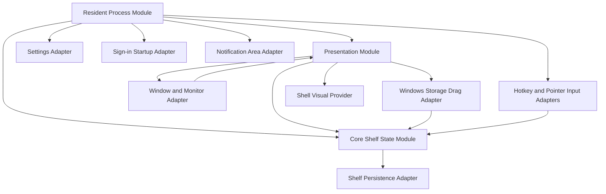
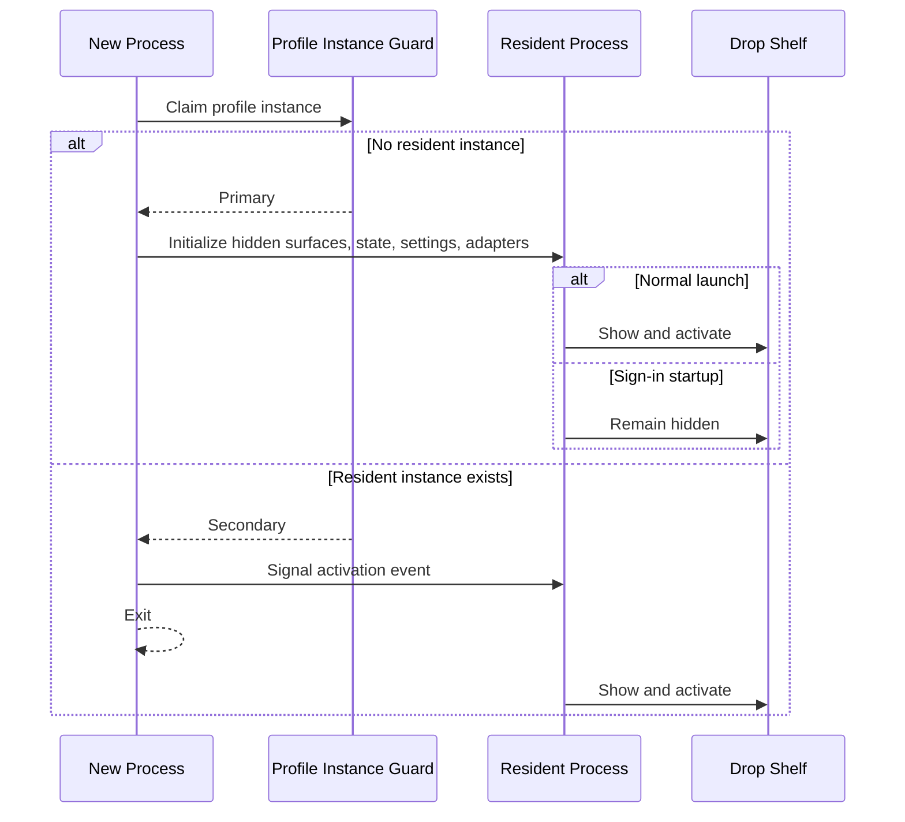
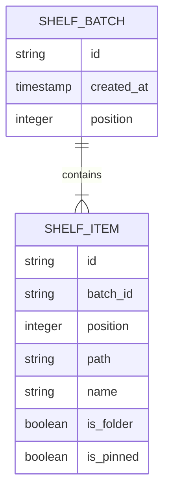
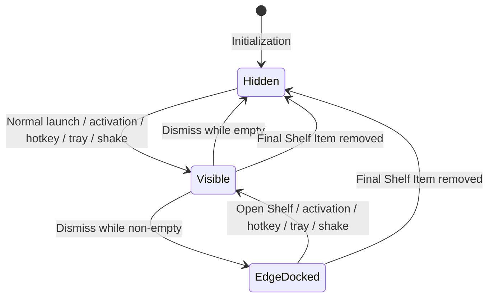
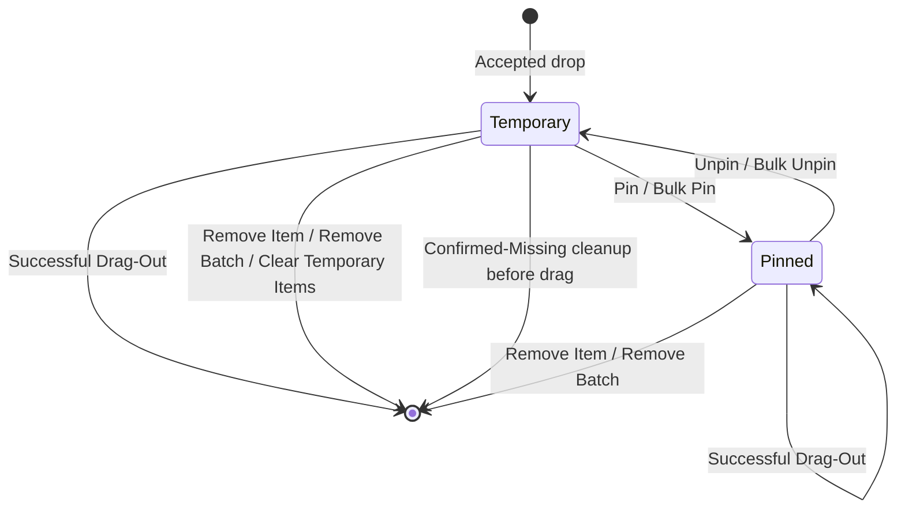
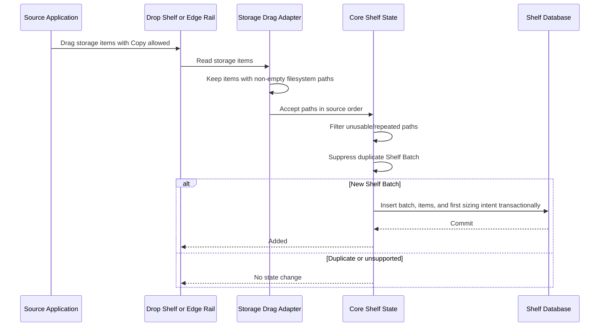
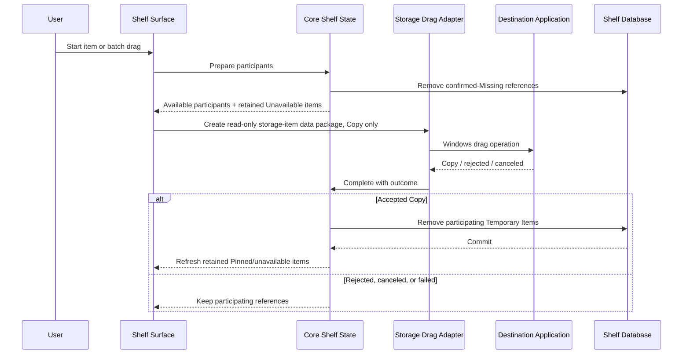
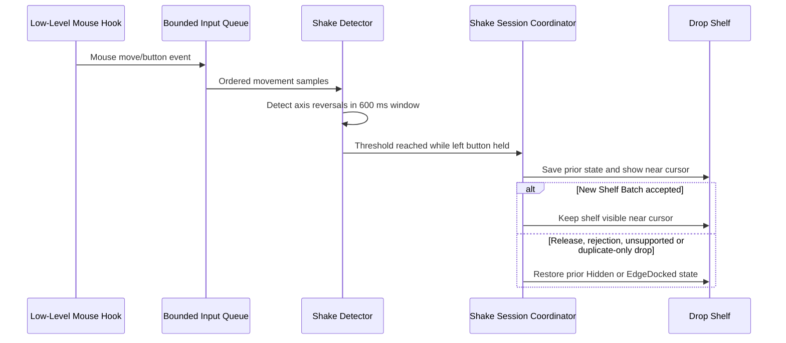

# DropCove Architecture

> Canonical target architecture for DropCove.

This document defines the architecture required to implement the target DropCove application on Windows. It is Windows-specific but implementation-language-neutral. Product behavior, installation, settings, and user workflows are defined in [SPECIFICATION.md](SPECIFICATION.md).

[`DropCove.md`](DropCove.md) is retained as implementation history and design evidence. If it conflicts with this document or `SPECIFICATION.md`, the two canonical documents take precedence.

## 1. Architectural goals

DropCove is a resident, event-driven utility. Its architecture preserves these invariants:

1. **References, not copies** — the application stores filesystem paths and metadata; it does not import source file contents into application storage.
2. **One state owner** — all Shelf Batch, Shelf Item, display, placement, and sizing mutations pass through one core state module.
3. **Durable user-visible mutations** — accepted drops, pinning, removals, drag-out consumption, rail placement, and retained sizing intent are persisted.
4. **Event-driven residency** — hotkeys, pointer hooks, drag events, foreground changes, display changes, and window messages drive work. There is no continuous cursor or window polling loop.
5. **Disposable presentation state** — windows project core state; they do not become a second durable state owner.
6. **Windows interoperability behind adapters** — global input, shell drag-and-drop, monitor geometry, z-order, tray integration, and shell visuals remain isolated from domain rules.
7. **Safe failure preference** — an extra retained reference is safer than incorrectly removing one.

## 2. Module map



### 2.1 Resident Process Module

Owns application lifetime:

- resolves the per-user profile directory;
- enforces one resident instance per profile;
- redirects later launches to the existing instance;
- initializes persistence, settings, tray, hotkey, shake detection, and windows;
- distinguishes normal launch from sign-in startup;
- exits only through the notification-area **Exit DropCove** command, installer shutdown request, or a fatal startup error.

Its interface is small: initialize, show the shelf, open Settings or About, and exit. The notification-area menu and Drop Shelf utilities reuse the same singleton openers rather than constructing independent windows.

### 2.2 Presentation Module

Owns transient Windows surfaces:

- floating **Drop Shelf**;
- docked **Edge Rail** and its **Rail Handle**;
- **Manage Items** popup or flyout;
- Settings window;
- About Surface;
- confirmations, status messages, and drag feedback.

Presentation surfaces render projections of core state. They request mutations through the Core Shelf State Module and refresh only after an operation succeeds or a documented rollback completes.

The dedicated Drop Shelf Clear confirmation is a resident-owned native window, not a WebView overlay. It disables native interaction with its owner and guards resident dismissal, movement, resize, OLE drop, and frontend mutation requests until cancellation or confirmation. Its request/confirm lifecycle rechecks authoritative Shelf state and delegates to the existing Core Shelf State mutation. Cancellation, close, setup failure, and shutdown release modal ownership; Edge Rail confirmation ownership remains unchanged.

The About Surface has a separate, non-modal singleton lifecycle and a read-only metadata projection. Product name and version come from the running Tauri package; author and Source come from Cargo package metadata. Homepage remains absent until there is a product site. Its window is denied unrelated custom commands, while capabilities allow only its required window lifecycle and canonical external Source link. The Clear window similarly receives only its confirmation interface and core window/event access.

### 2.3 Core Shelf State Module

Owns:

- newest-first Shelf Batch order;
- source-order Shelf Items within each batch;
- duplicate suppression;
- Temporary and Pinned Item lifecycle;
- availability classification supplied at event boundaries;
- display state;
- remembered rail monitor;
- preferred width and optional Manual Height Override;
- preparation and completion of item or batch drag-out;
- serialized mutations.

This is the main seam for reproducing DropCove behavior. Presentation and platform adapters must not independently implement lifecycle rules.

### 2.4 Shelf Persistence Adapter

Stores durable shelf state in a per-user SQLite database using write-ahead logging. It serializes database operations and performs integrity checking during open.

### 2.5 Settings and Startup Adapters

- The Settings Adapter atomically reads and replaces a JSON settings file and owns the configured rail edge and target-monitor preference.
- The Startup Adapter owns the current-user Windows sign-in registration and launches DropCove with the hidden-start option.

### 2.6 Windows Integration Adapters

Separate adapters own:

- storage-item drag-in and copy-only drag-out;
- global hotkey registration;
- low-level mouse events for Shake-to-open;
- window styles, z-order, resize hit testing, DPI conversion, and monitor placement;
- foreground-window tracking for topmost repair and Edge Rail fullscreen policy;
- notification-area icon and menu;
- file/folder icons and thumbnails.

## 3. Process and activation lifecycle



The instance identity is profile-specific. A normal profile and an explicit test profile can run independently because each has distinct storage paths, instance guards, and activation events.

## 4. Domain model

### 4.1 Entities and value state

| Concept | Durable fields | Rules |
|---|---|---|
| **Shelf Batch** | Identifier, creation time, position | Represents one accepted drop; ordered newest-first. |
| **Shelf Item** | Identifier, batch identifier, position, path, display name, folder flag, pinned flag | Represents one path occurrence inside one batch. |
| **Display State** | Not persisted as a standalone value | `Hidden`, `Visible`, or `EdgeDocked`. |
| **Rail Placement** | Settings: target monitor identifier and `Left` or `Right` edge; shelf state: remembered monitor identifier | A configured target monitor takes precedence over remembered placement; temporary fallback does not rewrite the configured preference. |
| **Sizing State** | Preferred logical width, nullable Manual Height Override | Automatic Shelf Sizing derives the exact current height from preferred width and responsive batch rows when manual height is absent. |
| **Availability** | Not persisted | Recomputed as `Available`, `Missing`, or `Unavailable` at restore and drag boundaries. |

### 4.2 Relationships



A Shelf Batch never owns a pinned state. Bulk Pinning derives the current tri-state from its Shelf Items and then updates every item atomically.

## 5. State machines

### 5.1 Display state



Additional rules:

- Sign-in startup remains `Hidden` after initialization.
- `Hidden` can retain Shelf Items after sign-in startup and during temporary restoration flows; ordinary user dismissal with content produces `EdgeDocked`.
- Shake-to-open temporarily changes presentation placement. It does not introduce a fourth durable display state.
- Removing the final Shelf Item resets sizing state to its default and hides every shelf surface.

### 5.2 Shelf Item lifecycle



A Successful Drag-Out means that the destination reports the Windows `Copy` operation when the drag ends. It does not guarantee the destination's later internal processing.

## 6. Core mutation interfaces and invariants

The Core Shelf State Module exposes behavior equivalent to these operations:

| Operation | Result and invariant |
|---|---|
| Accept one incoming drop | Creates zero or one Shelf Batch after filtering and duplicate suppression. |
| Pin or unpin one Shelf Item | Persists before callers observe the replacement item state. |
| Set all items pinned/unpinned | One durable operation; no batch-level pin field. |
| Remove Item | Removes one reference and prunes an empty batch. |
| Remove Batch | Removes the batch and every contained reference. |
| Clear Temporary Items | Removes only Temporary Items across all batches; Pinned Items remain. |
| Prepare batch drag | Reclassifies paths, durably removes Missing Items, retains Unavailable Items, and records participating Available Items. |
| Complete item or batch drag | Consumes participating Temporary Items only after accepted `Copy`; Pinned Items remain. |
| Dismiss shelf | Chooses `Hidden` when empty or records the actual dismissal monitor and chooses `EdgeDocked` when non-empty; rail edge and target-monitor preference remain settings-owned. |
| Save sizing intent | Persists while content exists; pending empty-shelf intent is persisted with the first accepted batch. |

Mutations are serialized. A persistence failure must not leave a user-observable partial mutation. An accepted-drop implementation may optimistically stage memory state, but it must remove that state if the durable insert fails.

## 7. Drag-in flow

DropCove consumes the Windows storage-item data package rather than requiring callers to know a particular UI framework or COM interface.



### 7.1 Path and duplicate rules

- A usable item supplies a non-empty filesystem path.
- Paths repeated within one payload are removed using ordinal case-insensitive comparison; the first occurrence keeps its source order.
- The path strings are not canonicalized and separators are not rewritten.
- An incoming batch is duplicate when its complete path set matches any retained batch, unordered and ordinal case-insensitive.
- Partial overlap is not duplicate.
- A duplicate-only drop is a silent no-op: no persistence, sizing, ordering, scrolling, or status change.
- A mixed payload accepts supported filesystem items and counts skipped unsupported entries.

## 8. Drag-out flow



Preparation and completion are intentionally separate. Whole-batch completion consumes only the Available Items recorded during preparation, preventing later state changes from consuming unrelated items.

## 9. Availability classification

Availability is evaluated at event boundaries, not through a filesystem watcher:

- application restore;
- shelf presentation refresh where required;
- immediately before batch drag-out.

Classification rules:

| State | Meaning | Drag preparation behavior |
|---|---|---|
| **Available** | Filesystem attributes can be read. | Participates in drag-out. |
| **Missing** | The item or directory is confirmed absent while its root remains available. | Reference is durably removed before drag begins. |
| **Unavailable** | The root, volume, network location, cloud provider, or permission state prevents a reliable existence decision. | Reference is retained and excluded from that drag. |

When a batch contains both Available and Unavailable Items, presentation asks whether to drag only the Available Items. Canceling that confirmation does not restore Missing Items already removed during preparation.

## 10. Persistence architecture

### 10.1 Shelf database

Default path:

```text
%LOCALAPPDATA%\DropCove\shelf.db
```

The database uses foreign keys, write-ahead logging, serialized access, and an integrity check on open.

| Table | Columns | Purpose |
|---|---|---|
| `shelf_batches` | `id`, `created_at`, `position` | Newest-first batch order. |
| `shelf_items` | `id`, `batch_id`, `position`, `path`, `name`, `is_folder`, `is_pinned` | Ordered item references and lifecycle state. |
| `shelf_ui_state` | singleton `id`, nullable `rail_monitor` | Monitor actually used for the latest non-empty shelf dismissal. |
| `shelf_settings` | singleton `id`, `preferred_width`, nullable `manual_height` | Retained user sizing intent. |

The database does not store availability, source bytes, icons, or thumbnail bytes.

When no Shelf Items remain, empty batches and persisted sizing state are removed.

### 10.2 Settings file

Default path:

```text
%LOCALAPPDATA%\DropCove\settings.json
```

Settings are written to a temporary file, flushed, and atomically moved over the active file. Missing, unreadable, or malformed settings load the defaults.

`RailEdge` and `RailMonitorId` are settings-owned. A non-empty `RailMonitorId` is an explicit target-monitor preference; an empty value requests the remembered `shelf_ui_state.rail_monitor`.

### 10.3 Sign-in startup registration

The current-user Windows `Run` entry contains the quoted executable path followed by `--autostart`. The application owns this registration; the installer does not enable or disable it independently.

### 10.4 Recovery

On a recoverable database open, format, integrity, or I/O failure:

1. Preserve `shelf.db` as `shelf.corrupt-<timestamp>.db`.
2. Move matching `-wal` and `-shm` sidecars with the backup when present.
3. Create and open a clean database.
4. Start with an empty shelf.
5. Notify the user through the notification area and include the backup path.

This favors continued application availability while preserving evidence for manual recovery.

## 11. Window, monitor, and DPI architecture

- The process declares Per-Monitor V2 DPI awareness.
- Durable dimensions use logical pixels; native window bounds use physical pixels.
- Conversion follows `physical = logical × monitor DPI / 96`.
- Shelf and rail bounds are clamped to the selected monitor's work area.
- Hotkey, notification-area activation, and ordinary launch use the monitor containing the cursor.
- Shake-to-open places the shelf near the current cursor.
- Edge Rail uses `RailEdge` from settings for its left/right side.
- A connected non-empty `RailMonitorId` is the target monitor. If it is unavailable, the rail temporarily uses the Windows primary display without rewriting that setting.
- An empty `RailMonitorId` uses the remembered `shelf_ui_state.rail_monitor` when connected. An unavailable remembered monitor temporarily falls back to the Windows primary display.
- If no remembered monitor exists during non-empty shelf dismissal, the monitor containing the Drop Shelf is used.
- Every non-empty shelf dismissal stores the actual selected monitor. A display-change fallback while already docked does not by itself rewrite remembered placement.
- Open Shelf resolves to the monitor where the rail is currently docked, including any configured-monitor selection or temporary primary-display fallback; it does not jump to a stale remembered monitor.
- Display and DPI changes trigger reflow through window/display events.

The Drop Shelf is borderless but retains native resize behavior on all edges and corners. The Edge Rail is a separate no-activate window so hover, drop-in, drag-out, and management do not steal foreground focus.
The Edge Rail disables the Windows redirection bitmap when its transparent window is created. CSS retains ownership of the antialiased 8-logical-pixel outer corners and square docked edge; no binary native window region clips their fractional-alpha pixels. This avoids white native backing paint without turning the rounded desktop-facing corners into jagged edges.

## 12. Foreground, topmost, and fullscreen behavior

Two foreground trackers have distinct responsibilities:

1. **Drop Shelf tracker** — while the shelf is visible, foreground changes reassert its topmost z-order without activating it.
2. **Edge Rail tracker** — while rail visibility is requested and showing over fullscreen is disabled, foreground changes reevaluate whether the selected monitor is fully covered. The rail hides while covered, closes rail flyouts and unconfirmed Clear prompts, and returns as a collapsed handle afterward without canceling an active native drag.

The fullscreen rule is geometric monitor coverage, not application-name or game detection.

The no-activate Edge Rail does not add a global keyboard-navigation hook. Keyboard access continues through the global hotkey and the Drop Shelf's focused workflow.

## 13. Shake-to-open pipeline



Sensitivity profiles change minimum movement and required reversal count. A 500 ms detector cooldown prevents immediate retriggering. The low-level callback performs minimal work and queues analysis instead of polling cursor position.

The 0.0.6 adapter installs `WH_MOUSE_LL` on a dedicated message-pumping thread. Its callback copies scalar input into a bounded 256-sample queue and schedules detection after the callback returns. Only detection/release results are posted to the Shelf HWND; Resident, Window, and Settings operations run on Tauri's UI thread. Teardown removes the hook and joins the thread before releasing receiver ownership. Queued results carry a runtime generation so a disabled or replaced hook cannot reopen the Shelf.

The Resident coordinator assigns each transient Shake session an ID. Native OLE drop entry marks the matching session pending before off-thread persistence starts; only that session's completion may promote or restore presentation. Application-owned drag-out cannot start a Shake session. Rail restoration and normal docking reevaluate fullscreen coverage after committing the display transition, avoiding stale occlusion state.

## 14. Presentation projections and visual resources

- Compact cards keep bounded preview data; a batch requests visuals for at most its first three Shelf Items.
- Batch collections and Manage Items lists use virtualized presentation controls.
- Full item projections are created when management UI opens and cleared when it closes or its owner disappears.
- Icon and thumbnail loading is asynchronous. File/folder icons provide fallback when image thumbnails are unavailable.
- Each surface owns cancellation and release of its active image resources even when visual loading is coordinated centrally.
- Animations are short state-change effects. Non-essential transitions are skipped when Windows disables client-area animations.

## 15. Concurrency and error handling

| Concern | Architectural rule |
|---|---|
| Core mutations | Serialize through one mutation gate. |
| Database operations | Serialize independently and execute away from presentation input handling. |
| Shell visuals | Load asynchronously and cancel/release with presentation lifetime. |
| Hook callbacks | Do minimal capture work and queue processing. |
| Persistence failure | Preserve prior user-observable state and report failure. |
| Hotkey failure at startup | Keep resident process running; warn through the tray. |
| Hotkey failure while saving | Keep prior registration and settings. |
| Shake hook failure | Keep the rest of the application usable and warn. |
| Settings read failure | Use defaults. |
| Settings apply failure | Attempt rollback; warn explicitly if rollback is incomplete. |

## 16. Required Windows capabilities

A conforming reimplementation needs Windows facilities equivalent to:

- global hotkey registration;
- low-level mouse event observation;
- notification-area icon, menu, and warnings;
- storage-item drag-and-drop with destination result reporting;
- topmost and no-activate window behavior;
- foreground-window event hooks;
- monitor enumeration, work-area bounds, and Per-Monitor V2 DPI;
- borderless native resizing and hit testing;
- filesystem attribute checks;
- shell file/folder icons and image thumbnails;
- per-user startup registration;
- embedded transactional persistence.

The internal framework and implementation language may vary. The state transitions, persistence invariants, Windows integration semantics, and user-visible behavior defined here must remain unchanged.
